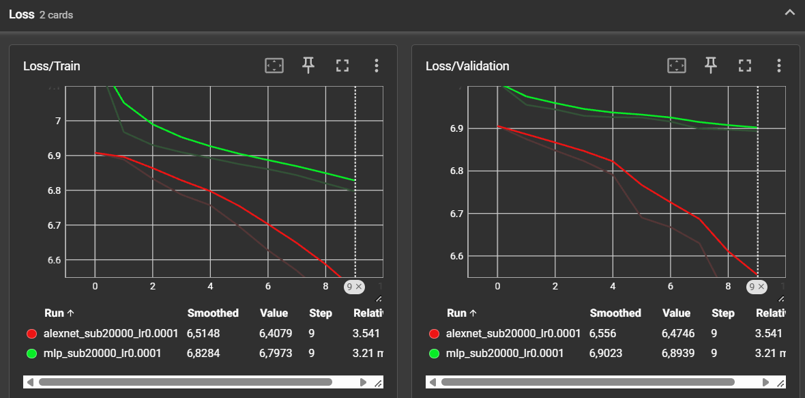
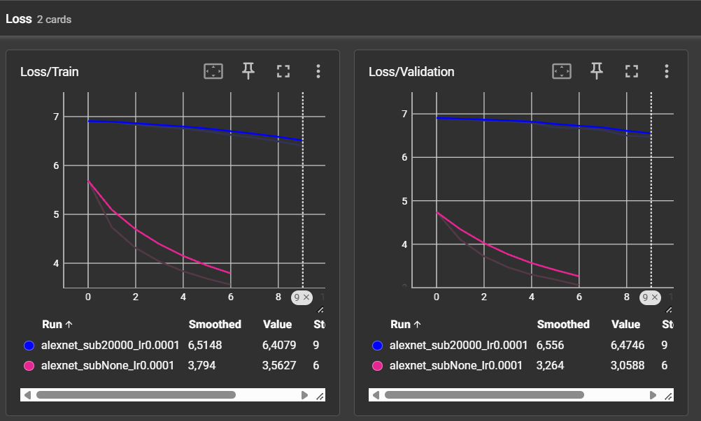

# CSC8607 — Introduction au Deep Learning

## TP3 — Réseaux convolutifs

**Étudiant :** Mohamed Rayen Jomaa  
**Date :** 14/10/2026

---

# Exercice 1 — Préparation d'ImageNet et augmentation de données

Le dataset utilisé est ImageNet 2012, contenant 1000 classes.

Les images d'entraînement sont préparées avec :

```python
RandomResizedCrop(227)
RandomHorizontalFlip()
ToTensor()
Normalize(...)
```

Pour la validation, les transformations utilisées sont :

```python
Resize(256)
CenterCrop(227)
ToTensor()
Normalize(...)
```

## Question 1 — Rôle de la normalisation et risque de data leakage

Sans `transforms.Normalize`, les images restent converties en tenseurs, mais leurs canaux ne sont pas centrés et réduits avec les statistiques d'ImageNet.

La descente de gradient reste possible, mais les entrées ont alors des distributions et des échelles moins bien conditionnées. Les activations et les gradients peuvent donc être moins stables et l'optimisation peut devenir plus lente ou plus difficile.

Les statistiques de normalisation doivent être calculées uniquement sur le jeu d'entraînement.

Si la moyenne et l'écart-type étaient également calculés à partir du jeu de validation, des informations provenant de ce dernier seraient utilisées dans le prétraitement des données d'entraînement. Cela constituerait une fuite de données (`data leakage`) et rendrait l'évaluation moins indépendante.

---

## Question 2 — Pourquoi des transformations différentes pour le train et la validation ?

Pendant l'entraînement, nous utilisons :

```python
RandomResizedCrop(227)
RandomHorizontalFlip()
```

Ces transformations génèrent différentes versions d'une même image et augmentent artificiellement la diversité des données vues par le modèle.

Elles permettent notamment de limiter la mémorisation des exemples d'entraînement.

Pour la validation, nous utilisons au contraire :

```python
Resize(256)
CenterCrop(227)
```

sans transformation aléatoire.

La validation doit être déterministe afin qu'une même image soit évaluée de la même façon à chaque époque. Cela permet de comparer correctement les performances du modèle au cours de l'entraînement.

---

## Question 3 — Exemple où `RandomHorizontalFlip` serait néfaste

Une symétrie horizontale serait problématique pour une tâche où la distinction gauche/droite détermine la classe.

Par exemple, dans une classification de panneaux routiers :

```text
Tourner à gauche
Tourner à droite
```

un `RandomHorizontalFlip` pourrait transformer visuellement un panneau indiquant « gauche » en un panneau indiquant « droite », alors que son label resterait inchangé.

L'augmentation produirait alors une image avec une étiquette incorrecte.

---

# Exercice 2 — Étude du MLP et d'AlexNet

# Question 2.a — MLP baseline

Le MLP reçoit une image RGB de taille `227 × 227`.

Après aplatissement, la taille du vecteur d'entrée est :

```math
3 \times 227 \times 227 = 154587
```

L'architecture utilisée est :

```text
154587 → 256 → 256 → 1000
```

## Nombre de paramètres

### Première couche

```math
154587 \times 256 = 39574272
```

Avec les 256 biais :

```math
39574272 + 256 = 39574528
```

### Deuxième couche

```math
256 \times 256 = 65536
```

Avec les 256 biais :

```math
65536 + 256 = 65792
```

### Couche de sortie

```math
256 \times 1000 = 256000
```

Avec les 1000 biais :

```math
256000 + 1000 = 257000
```

### Total

| Couche | Poids | Biais | Total |
| --- | ---: | ---: | ---: |
| `154587 → 256` | 39 574 272 | 256 | 39 574 528 |
| `256 → 256` | 65 536 | 256 | 65 792 |
| `256 → 1000` | 256 000 | 1 000 | 257 000 |
| **Total** | **39 895 808** | **1 512** | **39 897 320** |

Le script PyTorch confirme :

```text
Paramètres avec biais  : 39,897,320
Paramètres sans biais  : 39,895,808
Nombre total de biais  : 1,512
```

La première couche contient :

```math
\frac{39574528}{39897320} \times 100
\approx 99.19\%
```

des paramètres du réseau.

C'est donc bien la première couche linéaire qui concentre plus de 99 % des paramètres du MLP.

---

## Défaut structurel du MLP sur une image aplatie

Le principal défaut ne vient pas uniquement du nombre très élevé de paramètres.

L'opération `flatten` transforme l'image en un simple vecteur et fait perdre explicitement sa structure spatiale.

Deux pixels voisins dans l'image ne sont plus traités différemment de deux pixels très éloignés.

Le modèle ne bénéficie donc pas directement :

- de la localité spatiale ;
- du partage de poids ;
- de la structure 2D de l'image.

Cela rend le MLP beaucoup moins adapté à la classification d'images qu'un réseau convolutif.

---

# Question 2.b — Analyse d'AlexNet

Les dimensions spatiales successives obtenues sont :

```text
227 × 227
→ Conv1    : 56 × 56
→ MaxPool1 : 27 × 27
→ Conv2    : 27 × 27
→ MaxPool2 : 13 × 13
→ Conv3    : 13 × 13
→ Conv4    : 13 × 13
→ Conv5    : 13 × 13
→ MaxPool3 : 6 × 6
```

Après le dernier pooling :

```text
256 × 6 × 6
```

Après aplatissement :

```math
256 \times 6 \times 6 = 9216
```

## Tableau complet d'AlexNet

La mémoire des activations est calculée pour une image en utilisant des flottants 32 bits, soit 4 octets par valeur.

| Couche | Taille entrée | Filtres / neurones | K | S | P | Taille sortie | Paramètres | Mémoire sortie (KB) |
| --- | --- | ---: | ---: | ---: | ---: | --- | ---: | ---: |
| Conv1 + ReLU | `3 × 227 × 227` | 64 | 11×11 | 4 | 2 | `64 × 56 × 56` | 23 296 | 784.00 |
| MaxPool1 | `64 × 56 × 56` | - | 3×3 | 2 | 0 | `64 × 27 × 27` | 0 | 182.25 |
| Conv2 + ReLU | `64 × 27 × 27` | 192 | 5×5 | 1 | 2 | `192 × 27 × 27` | 307 392 | 546.75 |
| MaxPool2 | `192 × 27 × 27` | - | 3×3 | 2 | 0 | `192 × 13 × 13` | 0 | 126.75 |
| Conv3 + ReLU | `192 × 13 × 13` | 384 | 3×3 | 1 | 1 | `384 × 13 × 13` | 663 936 | 253.50 |
| Conv4 + ReLU | `384 × 13 × 13` | 256 | 3×3 | 1 | 1 | `256 × 13 × 13` | 884 992 | 169.00 |
| Conv5 + ReLU | `256 × 13 × 13` | 256 | 3×3 | 1 | 1 | `256 × 13 × 13` | 590 080 | 169.00 |
| MaxPool3 | `256 × 13 × 13` | - | 3×3 | 2 | 0 | `256 × 6 × 6` | 0 | 36.00 |
| Flatten + Dropout | `256 × 6 × 6` | `p=0.5` | - | - | - | `9216` | 0 | 36.00 |
| Linear1 + ReLU + Dropout | `9216` | 4096 | - | - | - | `4096` | 37 752 832 | 16.00 |
| Linear2 + ReLU | `4096` | 4096 | - | - | - | `4096` | 16 781 312 | 16.00 |
| Linear3 | `4096` | 1000 | - | - | - | `1000` | 4 097 000 | 3.91 |

La mémoire totale des sorties est :

```math
784
+182.25
+546.75
+126.75
+253.5
+169
+169
+36
+36
+16
+16
+3.90625
=
2339.15625\ \text{KB}
```

soit environ :

```math
\boxed{2340\ \text{KB par image}}
```

---

## Où sont concentrés les paramètres et les activations ?

Le nombre total de paramètres d'AlexNet est :

```text
61 100 840
```

Les trois couches fully-connected contiennent :

```text
Linear1 : 37 752 832
Linear2 : 16 781 312
Linear3 :  4 097 000
```

soit :

```math
58631144
```

paramètres.

Cela représente environ :

```math
\frac{58631144}{61100840} \times 100
\approx 95.96\%
```

des paramètres d'AlexNet.

L'essentiel des **poids** se trouve donc dans le `classifier`, principalement dans les couches `Linear1` et `Linear2`.

À l'inverse, l'essentiel de la mémoire des **activations** se trouve dans les premières couches convolutionnelles, car elles produisent de grandes cartes de caractéristiques.

Par exemple :

```text
Conv1 : 784 KB
Conv2 : 546.75 KB
```

---

## Comparaison de la mémoire des activations avec le MLP

Pour les sorties des trois couches linéaires du MLP :

```math
(256 + 256 + 1000) \times 4
=
6048\ \text{octets}
```

soit :

```math
\frac{6048}{1024}
=
5.91\ \text{KB}
```

Si l'on inclut également le grand vecteur d'entrée aplati, celui-ci représente environ :

```math
154587 \times 4 / 1024
\approx 603.86\ \text{KB}
```

et le total reste autour de :

```math
609.76\ \text{KB}
```

contre environ :

```text
2340 KB
```

pour AlexNet.

Le MLP possède beaucoup de paramètres car chaque valeur de l'image est connectée à chaque neurone de la première couche.

AlexNet partage au contraire les poids des filtres convolutionnels, mais produit de nombreuses grandes cartes de caractéristiques intermédiaires.

Cela explique pourquoi AlexNet peut avoir une mémoire d'activations nettement supérieure alors que les deux réseaux restent du même ordre de grandeur en nombre de paramètres.

---

# Question 2.c — Vérification de l'implémentation AlexNet

L'implémentation PyTorch complétée donne :

```text
Paramètres AlexNet : 61,100,840
Entrée AlexNet              : (1, 3, 227, 227)
Sortie après convolutions   : (1, 256, 6, 6)
Taille après flatten        : 9216
Sortie finale AlexNet       : (1, 1000)
```

Ces résultats sont cohérents avec les calculs précédents.

---

# Exercice 3 — Entraînement, Early Stopping et comparaison rapide

# Question 3.a — MLP vs AlexNet

Les deux réseaux ont été entraînés pendant 10 époques sur un sous-ensemble de :

```text
20 000 images d'entraînement
5 000 images de validation
```

avec :

```text
learning rate = 1e-4
batch size = 256
```

---

## Rôle de `model.train()` et `model.eval()`

AlexNet contient des couches :

```python
nn.Dropout(p=0.5)
```

Pendant :

```python
model.train()
```

le Dropout est actif. Une partie des activations est donc aléatoirement mise à zéro pendant l'entraînement.

Pendant :

```python
model.eval()
```

le Dropout est désactivé afin d'utiliser l'ensemble du réseau de manière déterministe pendant l'évaluation.

Si `model.eval()` était oublié pendant la validation, le Dropout continuerait à désactiver aléatoirement des neurones.

Les résultats de validation deviendraient alors aléatoires et généralement moins bons, ce qui rendrait les métriques moins fiables.

---

## Valeurs théoriques à l'initialisation

ImageNet contient 1000 classes équilibrées.

Un classificateur purement aléatoire possède donc une accuracy théorique de :

```math
\frac{1}{1000}
=
0.001
=
0.1\%
```

Pour une prédiction uniforme sur les 1000 classes, la `CrossEntropyLoss` théorique vaut :

```math
-\log\left(\frac{1}{1000}\right)
=
\log(1000)
\approx 6.9078
```

### Premières valeurs observées

Pour AlexNet :

```text
Epoch 1
Train Loss = 6.9080
Train Acc  = 0.0008
Val Loss   = 6.9059
Val Acc    = 0.0010
```

Ces valeurs correspondent presque exactement aux valeurs théoriques d'une initialisation aléatoire.

Pour le MLP :

```text
Epoch 1
Train Loss = 7.1932
Train Acc  = 0.0012
Val Loss   = 7.0085
Val Acc    = 0.0012
```

La loss est légèrement supérieure à `ln(1000)`, mais l'accuracy reste du même ordre de grandeur que la valeur aléatoire théorique.

Les premiers résultats sont donc cohérents avec l'initialisation des modèles.

---

## Comparaison TensorBoard — MLP vs AlexNet

### Accuracy


### Loss



À la dixième époque :

| Modèle | Train Loss | Val Loss | Train Accuracy | Val Accuracy |
| --- | ---: | ---: | ---: | ---: |
| MLP | 6.7973 | 6.8939 | 0.62 % | 0.42 % |
| AlexNet | 6.4079 | 6.4746 | 0.98 % | 0.80 % |

AlexNet apprend donc plus rapidement que le MLP sur ce sous-ensemble.

Sa loss diminue davantage et ses accuracies d'entraînement et de validation sont supérieures.

Cela s'explique principalement par le fait que les convolutions exploitent directement la structure spatiale et locale des images, alors que le MLP traite chaque image comme un grand vecteur après `flatten`.

Sur les 10 époques observées, aucun des deux modèles ne présente encore un sur-apprentissage très marqué : les losses de validation continuent globalement à diminuer.

---

# Question 3.b — AlexNet plus profond

Une variante d'AlexNet a été créée en ajoutant trois couches convolutionnelles supplémentaires après `Conv5` :

```text
Conv2d(256, 256, kernel_size=3, padding=1) + ReLU
Conv2d(256, 256, kernel_size=3, padding=1) + ReLU
Conv2d(256, 256, kernel_size=3, padding=1) + ReLU
```

Le nombre de paramètres passe de :

```text
AlexNet standard : 61 100 840
Deep AlexNet     : 62 871 080
```

Après 10 époques sur le même sous-ensemble :

| Modèle | Train Loss | Val Loss | Train Accuracy | Val Accuracy |
| --- | ---: | ---: | ---: | ---: |
| AlexNet standard | 6.4079 | 6.4746 | 0.98 % | 0.80 % |
| Deep AlexNet | 6.5329 | 6.5937 | 0.56 % | 0.60 % |

Le réseau plus profond présente donc des performances inférieures dès l'entraînement.

Cette dégradation ne correspond pas à du sur-apprentissage : dans un cas de sur-apprentissage, les performances sur le train seraient très bonnes tandis que celles sur la validation se dégraderaient.

Ici, même les performances d'entraînement sont moins bonnes.

Il s'agit plutôt d'une difficulté d'optimisation conduisant à du **sous-apprentissage au début de l'entraînement**.

L'ajout de plusieurs couches augmente la longueur du chemin parcouru par le gradient pendant la rétropropagation.

Sans mécanisme comme des connexions résiduelles ou des techniques de normalisation supplémentaires, les gradients doivent traverser davantage de transformations successives. Ils peuvent devenir plus faibles ou moins stables dans les premières couches.

Le réseau plus profond est donc plus difficile à optimiser, même s'il possède théoriquement une capacité plus importante.

---

# Exercice 4 — Entraînement long sur ImageNet complet

AlexNet a ensuite été lancé sur l'intégralité du dataset ImageNet avec :

```text
subset_size = None
num_epochs  = 50
batch_size  = 256
GPU         = NVIDIA L4
```

Le job Slurm utilisé était :

```text
Job ID : 9001
Nom    : alexnet-full
```

Le job a été volontairement arrêté après avoir obtenu suffisamment d'époques complètes pour réaliser l'analyse demandée.

Au total, **8 époques complètes** ont été obtenues.

---

## Profilage temporel

Les durées mesurées sont :

| Époque | Durée |
| ---: | ---: |
| 1 | 24 min 06 s |
| 2 | 24 min 04 s |
| 3 | 24 min 06 s |
| 4 | 24 min 06 s |
| 5 | 24 min 02 s |
| 6 | 24 min 02 s |
| 7 | 24 min 05 s |
| 8 | 23 min 54 s |

La durée moyenne d'une époque est d'environ :

```text
24 min 03 s
```

soit environ :

```math
24.052\ \text{minutes}
```

À cette vitesse, 100 époques nécessiteraient environ :

```math
100 \times 24.052
=
2405.2\ \text{minutes}
```

soit :

```math
\boxed{\approx 40.1\ \text{heures}}
```

c'est-à-dire environ :

```text
40 h 05 min
```

sans Early Stopping.

Cette estimation correspond principalement au temps de la boucle d'entraînement et n'inclut pas précisément tout le surcoût des évaluations de validation.

---

## Évolution de l'entraînement sur ImageNet complet

Les résultats obtenus sont :

| Époque | Train Loss | Train Accuracy | Val Loss | Val Accuracy |
| ---: | ---: | ---: | ---: | ---: |
| 1 | 5.6903 | 4.49 % | 4.7430 | 11.34 % |
| 2 | 4.7358 | 12.12 % | 4.1073 | 18.78 % |
| 3 | 4.3138 | 17.12 % | 3.7226 | 24.23 % |
| 4 | 4.0356 | 20.76 % | 3.4710 | 28.14 % |
| 5 | 3.8368 | 23.51 % | 3.2997 | 30.88 % |
| 6 | 3.6852 | 25.73 % | 3.1865 | 32.88 % |
| 7 | 3.5627 | 27.52 % | 3.0588 | 34.58 % |
| 8 | 3.4643 | 29.06 % | 2.9512 | 36.60 % |

Entre la première et la huitième époque :

```text
Train Loss : 5.6903 → 3.4643
Val Loss   : 4.7430 → 2.9512

Train Accuracy : 4.49 % → 29.06 %
Val Accuracy   : 11.34 % → 36.60 %
```

L'apprentissage reste donc très net pendant les huit premières époques.

---

## Comparaison TensorBoard — sous-ensemble vs dataset complet

### Accuracy


### Loss



Sur le sous-ensemble de 20 000 images, après 10 époques :

```text
Train Loss = 6.4079
Val Loss   = 6.4746

Train Accuracy = 0.98 %
Val Accuracy   = 0.80 %
```

Sur ImageNet complet, dès l'époque 7 :

```text
Train Loss = 3.5627
Val Loss   = 3.0588

Train Accuracy = 27.52 %
Val Accuracy   = 34.58 %
```

et à l'époque 8 :

```text
Train Loss = 3.4643
Val Loss   = 2.9512

Train Accuracy = 29.06 %
Val Accuracy   = 36.60 %
```

Le réseau généralise donc beaucoup mieux lorsqu'il dispose de l'ensemble des données.

Sur le petit sous-ensemble, le nombre d'exemples est faible par rapport à la capacité du réseau. Le modèle peut plus facilement s'adapter aux exemples disponibles et commencer à créer un écart entre entraînement et validation.

Avec environ 1,28 million d'images, le réseau rencontre une diversité beaucoup plus importante d'exemples.

Le sur-apprentissage est donc beaucoup plus faible, car le modèle ne peut pas mémoriser aussi facilement l'ensemble du dataset.

La Data Augmentation et le Dropout renforcent également cet effet de régularisation.

---

## Pourquoi `Loss/Validation` est-elle inférieure à `Loss/Train` ?

Pendant les premières époques du training complet, nous observons par exemple :

```text
Epoch 1
Train Loss = 5.6903
Val Loss   = 4.7430
```

La loss de validation est donc nettement inférieure à celle de l'entraînement.

Ce résultat s'explique notamment par deux différences techniques entre les phases d'entraînement et de validation.

### 1. Dropout

Pendant l'entraînement :

```python
model.train()
```

active les couches :

```python
nn.Dropout(p=0.5)
```

Une partie des activations est donc aléatoirement désactivée.

Le problème d'apprentissage est volontairement rendu plus difficile, ce qui augmente la loss d'entraînement.

Pendant la validation :

```python
model.eval()
```

désactive le Dropout.

Le réseau utilise alors toutes ses activations, ce qui peut réduire la loss de validation.

### 2. Data Augmentation

Les images d'entraînement utilisent :

```python
RandomResizedCrop(227)
RandomHorizontalFlip()
```

Le modèle reçoit donc des images modifiées aléatoirement et parfois plus difficiles à classifier.

Les images de validation utilisent au contraire :

```python
Resize(256)
CenterCrop(227)
```

sans augmentation aléatoire.

La validation est donc effectuée sur des images plus régulières et déterministes.

Ces deux mécanismes expliquent pourquoi, pendant les premières époques, nous pouvons observer :

```math
\text{Loss}_{validation}
<
\text{Loss}_{train}
```

sans qu'il s'agisse d'une anomalie.

---

# Conclusion

Les expérimentations montrent que l'architecture convolutionnelle AlexNet est nettement mieux adaptée aux images que le MLP utilisant un simple aplatissement.

Sur le sous-ensemble de 20 000 images, AlexNet apprend plus rapidement que le MLP.

L'ajout naïf de trois couches convolutionnelles supplémentaires ne permet pas d'améliorer les résultats : le réseau plus profond est plus difficile à optimiser et démarre plus lentement.

Enfin, l'entraînement sur ImageNet complet montre une très forte amélioration des performances par rapport au petit sous-ensemble :

```text
Époque 8
Train Accuracy = 29.06 %
Val Accuracy   = 36.60 %
Val Loss       = 2.9512
```

Une époque complète sur NVIDIA L4 nécessite environ `24 min 03 s`, ce qui correspond à environ `40 h 05 min` pour 100 époques en extrapolation simple, sans Early Stopping.
