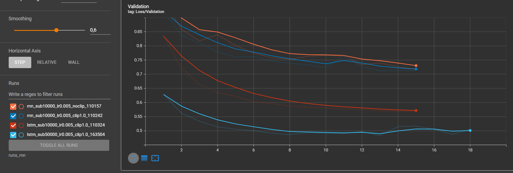
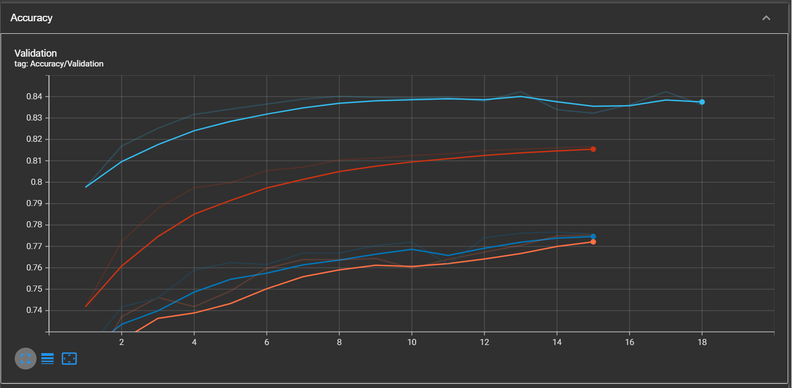
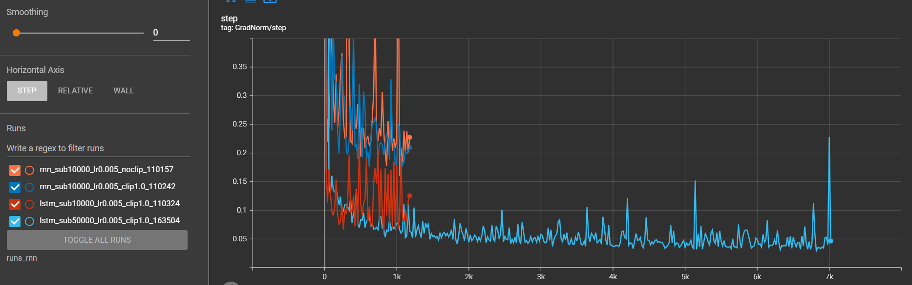
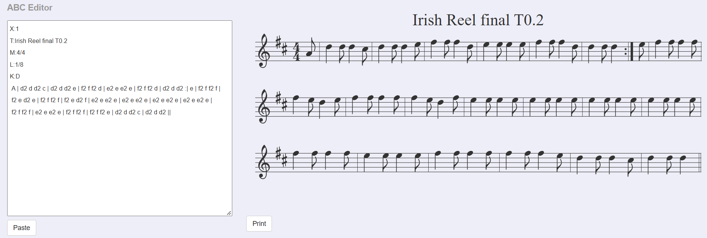
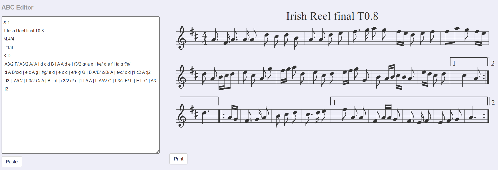
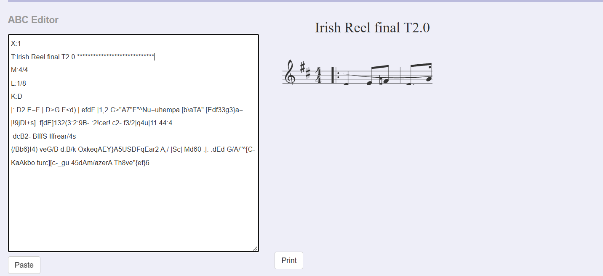

# CSC8607 - Introduction au Deep Learning

## TP4 - Réseaux récurrents et génération de séquences


# Exercice 1

## 1.a - Chargement et découverte du jeu de données

Après chargement des fichiers `train.json` et `validation.json`, nous obtenons :

```text
Nombre de chansons (Train) : 214122
Nombre de chansons (Val)   : 2162
```

Le jeu d'entraînement contient donc **214 122 partitions** et le jeu de validation **2 162 partitions**.

### Première partition du jeu d'entraînement

La première partition contenue dans `train_data[0]["abc notation"]` est :

```text
X:1
L:1/8
M:4/4
K:Emin
|: E2 EF E2 EF | DEFG AFDF | E2 EF E2 B2 |1 efe^d e2 e2 :|2 efe^d e3 B |: e2 ef g2 fe |
 defg afdf |1 e2 ef g2 fe | efe^d e3 B :|2 g2 bg f2 af | efe^d e2 e2 ||
```

Les premières lignes correspondent aux métadonnées de la notation ABC :

- `X:1` : identifiant de la partition ;
- `L:1/8` : durée de note utilisée par défaut ;
- `M:4/4` : métrique de la partition ;
- `K:Emin` : tonalité, ici Mi mineur.

Les lignes suivantes contiennent la musique proprement dite. Les lettres représentent les notes, les nombres indiquent des durées et les caractères comme `|`, `:|`, `|1` ou `|2` décrivent les mesures et les répétitions.

---

## 1.b - Construction du vocabulaire et padding

Les résultats obtenus sont :

```text
Taille du vocabulaire : 95 caractères uniques
Longueur moyenne      : 290.1 caractères
Longueur maximale     : 2968 caractères
SEQ_LENGTH            : 500
```

### Pourquoi utiliser `sorted(...)` pour construire le vocabulaire ?

Nous construisons le vocabulaire avec :

```python
unique_chars = sorted(list(set(all_text)))
```

Le `set` permet de supprimer les caractères dupliqués mais son ordre ne doit pas être utilisé comme correspondance caractère-indice persistante.

Le `sorted(...)` garantit un ordre déterministe.

C'est indispensable car les indices sont utilisés par :

```python
char_to_index
index_to_char
nn.Embedding
```

Si nous entraînions le modèle avec un mapping puis reconstruisions plus tard un mapping différent avant de charger les poids, un même indice pourrait représenter un autre caractère.

Par exemple, si l'indice `15` correspondait à `A` pendant l'entraînement mais à `B` lors de la génération, les poids sauvegardés ne seraient plus cohérents avec le vocabulaire.

---

### Pourquoi choisir `SEQ_LENGTH = 500` plutôt que la longueur maximale ?

La longueur moyenne des partitions est :

```text
290.1 caractères
```

alors que la partition la plus longue contient :

```text
2968 caractères
```

Nous avons donc choisi :

```text
SEQ_LENGTH = 500
```

qui est proche de deux fois la longueur moyenne.

Utiliser directement `2968` obligerait toutes les partitions courtes à être complétées jusqu'à cette longueur.

Cela aurait plusieurs conséquences :

- beaucoup plus de caractères de padding 
- davantage de mémoire GPU utilisée 
- davantage de pas temporels à traiter par le RNN/LSTM 
- une BPTT beaucoup plus longue 
- un temps d'entraînement nettement plus important.

Le choix de `500` permet donc de conserver une partie importante des partitions tout en limitant le coût de calcul.

---

# Exercice 2

## 2.a - Création du `MusicDataset`

Le dataset est auto-régressif.

Pour une séquence :

```text
c0 c1 c2 c3 ... c499
```

l'entrée est :

```text
c0 c1 c2 ... c498
```

et la cible :

```text
c1 c2 c3 ... c499
```

Le modèle apprend donc à prédire le caractère suivant à chaque pas temporel.

---

## Dimensions des tenseurs `x` et `y`

Nous avons :

```text
SEQ_LENGTH = 500
BATCH_SIZE = 128
```

Comme le premier caractère est retiré de `y` et le dernier de `x`, chaque séquence contient :

```math
500 - 1 = 499
```

caractères utilisés pour l'apprentissage.

Pour un batch complet :

```text
x.shape = (128, 499)
y.shape = (128, 499)
```

Le dernier batch peut naturellement contenir moins de 128 partitions si la taille du dataset n'est pas un multiple exact du batch size.

---

## Pourquoi utiliser `torch.long` ?

Les éléments de `x` ne sont pas directement des valeurs numériques continues. Ce sont des **indices de caractères dans le vocabulaire**.

Par exemple :

```text
'A' --> 12
'B' --> 13
'|' --> 72
```

La couche :

```python
nn.Embedding
```

attend des indices entiers, donc des tenseurs de type `torch.long`.

De la même manière, `y` contient les indices des classes à prédire et `CrossEntropyLoss` attend également les classes cibles sous forme d'entiers.

Nous utilisons donc :

```python
dtype=torch.long
```

et non `torch.float32`.

---

# 2.b - Architecture récurrente : RNN et LSTM

Nous utilisons l'architecture suivante :

```text
indices des caractères
        |
nn.Embedding
        |
nn.RNN ou nn.LSTM
        |
nn.Linear
        |
logits sur les 95 caractères
```

Les valeurs demandées pour le calcul sont :

```text
vocab_size    = 95
embedding_dim = 256
hidden_size   = 512
```

---

## Question 1 - Calcul du nombre de paramètres

### Couche Embedding

La matrice d'Embedding contient une ligne de taille `256` pour chacun des `95` caractères :

```math
N_{embedding}
=
95 \times 256
=
24320
```

Donc :

```text
Embedding = 24 320 paramètres
```

---

## RNN classique

Pour `nn.RNN`, PyTorch utilise :

- une matrice entrée --> état caché ;
- une matrice état caché --> état caché ;
- deux vecteurs de biais.

### `weight_ih`

```math
N_{ih}
=
512 \times 256
=
131072
```

### `weight_hh`

```math
N_{hh}
=
512 \times 512
=
262144
```

### Biais

PyTorch possède deux vecteurs de biais :

```math
N_{biais}
=
512 + 512
=
1024
```

Le bloc RNN contient donc :

```math
N_{RNN}
=
131072 + 262144 + 1024
```

```math
N_{RNN}
=
394240
```

---

## Couche de sortie

La couche :

```python
nn.Linear(hidden_size, vocab_size)
```

possède :

```math
N_{fc}
=
512 \times 95 + 95
```

```math
N_{fc}
=
48735
```

---

## Nombre total de paramètres du modèle RNN

```math
N_{total,RNN}
=
24320 + 394240 + 48735
```

```math
N_{total,RNN}
=
467295
```

La vérification avec `count_parameters()` donne bien :

```text
RNN : 467295
```

---

# Calcul des paramètres du LSTM

Un LSTM contient quatre transformations principales :

- forget gate 
- input gate 
- output gate 
- candidat de l'état de cellule.

Pour chaque transformation, il faut les mêmes types de poids et biais que dans un RNN simple.

### Matrice entrée --> états LSTM

```math
N_{ih,LSTM}
=
4 \times 512 \times 256
```

```math
N_{ih,LSTM}
=
524288
```

### Matrice état caché --> états LSTM

```math
N_{hh,LSTM}
=
4 \times 512 \times 512
```

```math
N_{hh,LSTM}
=
1048576
```

### Deux vecteurs de biais PyTorch

Chaque vecteur possède :

```math
4 \times 512 = 2048
```

paramètres.

Comme PyTorch utilise deux vecteurs :

```math
N_{biais,LSTM}
=
2048 + 2048
=
4096
```

Le bloc LSTM contient donc :

```math
N_{LSTM}
=
524288 + 1048576 + 4096
```

```math
N_{LSTM}
=
1576960
```

Le modèle complet contient :

```math
N_{total,LSTM}
=
24320 + 1576960 + 48735
```

```math
N_{total,LSTM}
=
1650015
```

La vérification expérimentale donne :

```text
LSTM: 1650015
```

---

## Pourquoi le bloc LSTM possède-t-il exactement quatre fois plus de paramètres que le bloc RNN ?

Le RNN classique réalise une seule transformation de l'entrée et de l'état précédent.

Le LSTM doit réaliser quatre transformations différentes pour calculer :

```text
forget gate
input gate
output gate
cell candidate
```

Chacune possède ses propres matrices de poids et ses propres biais.

Nous avons donc :

```math
1576960
=
4 \times 394240
```

Le **bloc récurrent** LSTM possède donc exactement quatre fois plus de paramètres que le bloc RNN dans cette configuration.

---

## Question 2 - Pourquoi utiliser `nn.Embedding` ?

Les indices des caractères sont uniquement des identifiants.

Par exemple :

```text
A --> 10
B --> 20
C --> 80
```

Cela ne signifie pas que `B` vaut deux fois `A`, ni que `C` est huit fois plus important que `A`.

Passer directement l'indice scalaire dans une couche linéaire introduirait donc artificiellement une relation numérique entre les caractères.

Avec :

```python
nn.Embedding(vocab_size, embedding_dim)
```

chaque caractère est associé à un vecteur dense appris.

Pour notre modèle :

```text
95 caractères --> vecteurs de dimension 256
```

Ces représentations sont apprises en même temps que le réseau et permettent au modèle de construire une représentation plus adaptée de chaque caractère.

---

## Question 3 - Différence entre le `hidden_state` du RNN et du LSTM

Pour un RNN simple, PyTorch retourne :

```python
out, h_n = rnn(...)
```

Le `hidden_state` correspond donc uniquement à :

```text
h_n
```

Pour une seule couche :

```text
h_n.shape = (1, batch_size, hidden_size)
```

Pour le LSTM :

```python
out, (h_n, c_n) = lstm(...)
```

le `hidden_state` est un tuple contenant deux états.

### `h_n` - Hidden state

`h_n` est l'état caché exposé par le LSTM.

Il représente les informations utilisées pour produire les sorties du réseau.

### `c_n` - Cell state

`c_n` est l'état interne de la cellule LSTM.

Il permet de transporter plus directement des informations sur plusieurs pas temporels et joue le rôle de mémoire à plus long terme.

Le LSTM retourne donc :

```text
(h_n, c_n)
```

alors que le RNN simple retourne uniquement :

```text
h_n
```

---

# Exercice 3

Nous avons réalisé les trois expériences demandées sur :

```text
subset_size = 10000
num_epochs  = 15
batch_size  = 128
lr          = 5e-3
```

Les trois runs sont :

```text
Run 1 : RNN  sans gradient clipping
Run 2 : RNN  avec max_grad_norm = 1.0
Run 3 : LSTM avec max_grad_norm = 1.0
```

---

## Question 1 - Pourquoi utiliser `reshape(-1, vocab_size)` ?

Avant la `CrossEntropyLoss`, les logits ont la forme :

```text
(batch_size, seq_len, vocab_size)
```

Dans notre cas, pour un batch complet :

```text
(128, 499, 95)
```

Les cibles ont la forme :

```text
(128, 499)
```

La `CrossEntropyLoss` doit recevoir une ligne de `95` scores pour chaque caractère à prédire.

Nous transformons donc :

```python
logits.reshape(-1, vocab_size)
```

en :

```text
(batch_size × seq_len, vocab_size)
```

et :

```python
y.reshape(-1)
```

en :

```text
(batch_size × seq_len)
```

Pour un batch complet :

```math
128 \times 499
=
63872
```

Nous obtenons donc :

```text
logits.reshape(-1, 95) --> (63872, 95)
y.reshape(-1)          --> (63872,)
```

La valeur numérique calculée automatiquement à la place de `-1` est donc :

```text
63872
```

pour un batch complet.

---

## Question 2 - Pourquoi effectuer le gradient clipping après `loss.backward()` mais avant `optimizer.step()` ?

L'ordre est :

```python
loss.backward()
torch.nn.utils.clip_grad_norm_(...)
optimizer.step()
```

`loss.backward()` calcule les gradients et les stocke dans les paramètres du modèle.

Avant cette instruction, il n'y a donc pas encore de gradient courant à écrêter.

`optimizer.step()` utilise ensuite les gradients pour modifier les poids.

Si nous faisions le clipping après `optimizer.step()`, les gradients trop importants auraient déjà été utilisés pour mettre à jour les paramètres.

Le clipping doit donc obligatoirement être effectué :

```text
après backward()
et
avant optimizer.step()
```

---

# Question 3 - Analyse des trois expériences

## Courbe de Validation Loss



## Courbe de Validation Accuracy



## Évolution de la norme des gradients



---

## Comparaison Run 1 / Run 2 : effet du Gradient Clipping

### Run 1 - RNN sans clipping

Résultats à l'époque 15 :

```text
Train Loss    : 0.7203
Val Loss      : 0.7171
Val Accuracy  : 77.54 %
Avg GradNorm  : 0.264
```

### Run 2 - RNN avec clipping

La meilleure Validation Loss est obtenue à l'époque 13 :

```text
Val Loss = 0.7118
```

La meilleure Validation Accuracy observée est :

```text
77.67 %
```

à l'époque 14.

À la dernière époque :

```text
Train Loss    : 0.7037
Val Loss      : 0.7128
Val Accuracy  : 77.58 %
Avg GradNorm  : 0.218
```

Dans nos expériences, le RNN sans clipping n'a pas présenté d'explosion importante et persistante des gradients.

Le clipping n'améliore donc pas radicalement les performances dans ce cas.

Le RNN avec clipping obtient néanmoins une Validation Loss légèrement meilleure et permet surtout de garantir que les mises à jour restent bornées si un gradient trop important apparaît.

Le rôle du Gradient Clipping est donc ici principalement **stabilisateur et préventif**.

---

## Quel problème théorique le Gradient Clipping corrige-t-il ?

Pendant la BPTT, le gradient traverse de nombreux pas temporels et réutilise plusieurs fois les mêmes poids récurrents.

Dans certaines situations, la norme du gradient peut augmenter très fortement : c'est l'**exploding gradient**.

Le Gradient Clipping impose une norme maximale.

Si :

```math
\lVert g \rVert_2 > \tau
```

le gradient est redimensionné :

```math
g
\leftarrow
\frac{\tau}{\lVert g \rVert_2}g
```

Il conserve donc sa direction mais sa norme est limitée.

---

# Comparaison Run 2 / Run 3 : RNN contre LSTM

### Run 2 - RNN avec clipping

Meilleures performances :

```text
Meilleure Val Loss : 0.7118
Meilleure Val Acc  : 77.67 %
```

### Run 3 - LSTM avec clipping

À l'époque 15 :

```text
Train Loss   : 0.5174
Val Loss     : 0.5686
Val Accuracy : 81.67 %
Avg GradNorm : 0.125
```

Le LSTM est donc nettement meilleur.

La Validation Accuracy passe approximativement de :

```text
77.7 % --> 81.7 %
```

et la Validation Loss diminue de :

```text
≈ 0.71 --> 0.57
```

---

## Pourquoi le LSTM apprend-il mieux les dépendances longues ?

Dans un RNN simple, l'état caché est modifié à chaque étape par une transformation non linéaire.

Pendant la BPTT, les gradients doivent traverser un grand nombre de transformations successives, ce qui peut provoquer du vanishing ou de l'exploding gradient.

Le LSTM possède un **cell state** :

```text
c_t
```

ainsi que plusieurs portes :

```text
forget gate
input gate
output gate
```

La mise à jour de l'état de cellule peut s'écrire :

```math
c_t
=
f_t \odot c_{t-1}
+
i_t \odot \hat{c}_t
```

Cette structure permet au réseau d'apprendre quelles informations doivent être conservées, oubliées ou ajoutées.

Le chemin plus direct à travers le `cell state` facilite également la propagation de l'information et du gradient sur plusieurs pas temporels.

Cela explique pourquoi notre LSTM capture mieux les dépendances longues des partitions musicales que le RNN classique.

---

# Question 4 - Effet du padding sur `Accuracy/Validation`

Nous utilisons :

```text
SEQ_LENGTH = 500
```

alors que la longueur moyenne d'une partition est seulement :

```text
290.1
```

Les partitions plus courtes sont complétées avec le caractère espace :

```text
" "
```

Par exemple, une partition de 250 caractères contient environ :

```math
500 - 250
=
250
```

caractères de padding.

Si ces positions sont incluses dans l'accuracy, le modèle peut obtenir beaucoup de prédictions correctes simplement en apprenant à prédire des espaces.

L'`Accuracy/Validation` peut donc être artificiellement optimiste par rapport à la capacité réelle du réseau à prédire les notes et les symboles musicaux.

---

## Modification de `CrossEntropyLoss`

La modification simple demandée est :

```python
pad_index = char_to_index[" "]
loss_fn = nn.CrossEntropyLoss(ignore_index=pad_index)
```

Les positions correspondant au padding ne contribuent alors plus à la loss.

Cependant, comme l'espace peut aussi apparaître naturellement dans la notation ABC, une solution encore plus propre serait d'utiliser un token de padding dédié, par exemple `<PAD>`.

Pour que l'accuracy elle-même ignore aussi le padding, il faudrait également masquer les positions de padding pendant le calcul de la métrique.

---

# Exercice 4

## 4.a - Génération avec propagation de l'état caché

Lors de la génération, l'amorce est d'abord donnée au modèle afin d'initialiser son état caché.

Ensuite, à chaque étape, nous ne donnons au modèle que le **dernier caractère généré** et nous réutilisons le `hidden_state`.

---

## Question 1 - Efficacité algorithmique

### Sans conservation du `hidden_state`

Si nous reconstruisions toute la séquence à chaque étape, le modèle traiterait successivement :

```text
1 caractère
2 caractères
3 caractères
...
N caractères
```

Le nombre total de caractères traités serait :

```math
1 + 2 + 3 + \cdots + N
```

soit :

```math
\frac{N(N+1)}{2}
```

La complexité serait donc :

```math
O(N^2)
```

---

### Avec conservation du `hidden_state`

Avec notre méthode, après le traitement initial de l'amorce, un seul nouveau caractère est envoyé au modèle à chaque itération.

Pour générer `N` caractères supplémentaires, la complexité devient donc :

```math
O(N)
```

La conservation de l'état caché évite ainsi de recalculer tout l'historique à chaque étape.

---

# Question 2 - Rôle mathématique de la température

La distribution utilisée pour échantillonner le caractère suivant est :

```math
P(y_t=c)
=
\frac{
\exp(z_{t,c}/T)
}{
\sum_{c'}
\exp(z_{t,c'}/T)
}
```

où `z` représente les logits et `T` la température.

---

## Lorsque `T --> 0+`

Quand :

```math
T \rightarrow 0^+
```

les différences entre les logits sont fortement amplifiées.

La probabilité se concentre alors presque entièrement sur le caractère ayant le logit maximal.

On se rapproche donc d'un **greedy decoding**, c'est-à-dire du choix :

```math
\mathrm{argmax}(z)
```

La génération devient plus déterministe mais également plus répétitive.

---

## Lorsque `T --> +∞`

Quand :

```math
T \rightarrow +\infty
```

nous avons :

```math
\frac{z_i}{T}
\rightarrow
0
```

et donc :

```math
\exp(z_i/T)
\rightarrow
1
```

pour tous les caractères.

La distribution tend alors vers :

```math
P(c)
\rightarrow
\frac{1}{V}
```

où `V` est la taille du vocabulaire.

Elle devient donc presque uniforme.

La génération devient de plus en plus aléatoire et perd progressivement la structure apprise par le modèle.

---

# Question 3 - Génération et analyse qualitative

Pour l'évaluation finale, nous utilisons le meilleur modèle LSTM obtenu avec l'entraînement plus long de la question 4.b.

L'amorce est :

```text
X:1
T:Irish Reel
M:4/4
L:1/8
K:D
```

Nous générons ensuite 300 caractères avec :

```text
T = 0.2
T = 0.8
T = 2.0
```

---

## Température `T = 0.2`

La partition générée est :

```text
X:1
T:Irish Reel
M:4/4
L:1/8
K:D
 A | d2 d d2 c | d2 d d2 e | f2 f f2 d | e2 e e2 e | f2 f f2 d | d2 d d2 :| e | f2 f f2 f |
 f2 e d2 e | f2 f f2 f | f2 e d2 f | e2 e e2 e | e2 e e2 e | e2 e e2 e | e2 e e2 e |
 f2 f f2 f | e2 e e2 e | f2 f f2 f | f2 f f2 e | d2 d d2 c | d2 d d2 ||
```

ABC Player parvient à produire un rendu complet de la partition.



La syntaxe générée est donc suffisamment cohérente pour être interprétée.

En revanche, on observe de très nombreuses répétitions, par exemple :

```text
e2 e e2 e
f2 f f2 f
```

La température faible favorise fortement les caractères les plus probables.

La génération est donc stable et cohérente, mais manque de variété musicale.

---

## Température `T = 0.8`

La partition générée est :

```text
X:1
T:Irish Reel
M:4/4
L:1/8
K:D
 A3/2 F/ A3/2 A/ A | d c d B | A A d e | f3/2 g/ a g | f/e/ d e f | fa g f/e/ |
 d A B/c/d | e c A g | f/g/ a d | e c d | e/f/ g G | B A/B/ c/B/ A | e/d/ c d |1 c2 A :|2
 d3 |: A/G/ | F3/2 G/ A | B c d | c3/2 d/ e |1 f A A | F A/A/ G | F3/2 E/ F | E F G | A3 :|2
 A E F | G G B | A e c | d2 c ||
```

ABC Player produit une partition largement complète :



Cette génération est beaucoup plus variée.

Nous observons :

- davantage de notes différentes ;
- plusieurs valeurs rythmiques ;
- des fractions comme `3/2` ;
- différentes structures de mesure ;
- des répétitions `|1`, `:|2`, etc.

La partition conserve donc une bonne cohérence tout en étant moins répétitive.

Parmi les températures testées, `T = 0.8` fournit le meilleur compromis entre **cohérence** et **richesse musicale**.

---

## Température `T = 2.0`

La génération obtenue est :

```text
X:1
T:Irish Reel
M:4/4
L:1/8
K:D
|: D2 E=F | D>G F<d) | efdF |1,2 C>"A7"F"^Nu=uhempa.[b\aTA" [Edf33g3}a= |!9jDl+s]  f[dE]132(3:2:9B- :2!cer! c2- f3/2|q4u|11 44:4
 dcB2- BfffS !ffrear/4s
{/Bb6}!4) veG/B d.B/k OxkeqAEY}A5USDFqEar2 A,/ |Sc| Md60 :|: .dEd G/A/"^[C-KaAkbo turc][c-_gu 45dAm/azerA Th8ve"{ef}6
```

ABC Player ne parvient à interpréter correctement qu'une petite partie du début :



La suite contient de nombreux caractères et constructions incohérentes avec une notation ABC propre.

La température élevée augmente fortement l'aléatoire lors de l'échantillonnage.

La diversité est donc très élevée mais la structure musicale et syntaxique est largement perdue.

---

## Comparaison des trois températures

| Température | Rendu ABC Player | Cohérence | Diversité | Observation |
| --- | --- | --- | --- | --- |
| `0.2` | Complet | Forte | Faible | Très répétitif |
| `0.8` | Largement complet | Bonne | Bonne | Meilleur compromis |
| `2.0` | Partiel | Faible | Très forte | Trop chaotique |

Dans notre expérience, la température :

```text
T = 0.8
```

est donc la plus intéressante pour la génération musicale.

---

# 4.b - Entraînement à plus grande échelle avec Slurm

Pour améliorer le générateur musical, nous avons lancé un job Slurm avec :

```text
rnn_type      = "lstm"
hidden_size   = 1024
embedding_dim = 256
subset_size   = 50000
batch_size    = 128
max_grad_norm = 1.0
num_epochs    = 30
patience      = 5
```

Le modèle est donc plus grand et utilise cinq fois plus de partitions que lors de l'expérience rapide.

---

## Résultats de l'entraînement long

Les résultats obtenus sont :

| Époque | Train Loss | Val Loss | Val Accuracy | Avg GradNorm |
| ---: | ---: | ---: | ---: | ---: |
| 1 | 0.8924 | 0.6285 | 79.76 % | 17.176 |
| 2 | 0.5854 | 0.5623 | 81.69 % | 0.082 |
| 3 | 0.5408 | 0.5339 | 82.52 % | 0.070 |
| 4 | 0.5152 | 0.5139 | 83.17 % | 0.065 |
| 5 | 0.4982 | 0.5055 | 83.41 % | 0.061 |
| 6 | 0.4837 | 0.5004 | 83.65 % | 0.057 |
| 7 | 0.4741 | 0.4914 | 83.88 % | 0.054 |
| 8 | 0.4662 | 0.4864 | 84.01 % | 0.053 |
| 9 | 0.4569 | 0.4936 | 83.97 % | 0.050 |
| 10 | 0.4603 | 0.4914 | 83.94 % | 0.053 |
| 11 | 0.4708 | 0.4905 | 83.97 % | 0.052 |
| 12 | 0.4844 | 0.4976 | 83.79 % | 0.058 |
| 13 | **0.4719** | **0.4829** | **84.23 %** | 0.046 |
| 14 | 0.4636 | 0.5144 | 83.39 % | 0.049 |
| 15 | 0.4726 | 0.5166 | 83.23 % | 0.059 |
| 16 | 0.4882 | 0.5053 | 83.62 % | 0.061 |
| 17 | 0.4717 | 0.4877 | 84.23 % | 0.048 |
| 18 | 0.4613 | 0.5046 | 83.62 % | 0.048 |

La meilleure Validation Loss est obtenue à l'époque :

```text
13
```

avec :

```text
Train Loss   = 0.4719
Val Loss     = 0.4829
Val Accuracy = 84.23 %
```

Après l'époque 13, cinq époques consécutives n'améliorent plus la meilleure Validation Loss.

L'Early Stopping est donc déclenché à :

```text
époque 18
```

Le modèle utilisé pour les générations finales est le modèle sauvegardé à la meilleure Validation Loss.

---

## Observation sur les gradients

À la première époque, nous avons mesuré :

```text
Avg GradNorm = 17.176
```

alors que :

```text
max_grad_norm = 1.0
```

`clip_grad_norm_()` renvoie la norme mesurée avant son écrêtage.

Cette valeur montre donc que le Gradient Clipping est réellement utile au début de cet entraînement pour éviter une mise à jour trop importante.

Dès l'époque 2 :

```text
Avg GradNorm = 0.082
```

puis la norme reste généralement autour de :

```text
0.05 à 0.08
```

L'entraînement devient donc beaucoup plus stable.

---

## Comparaison avec le LSTM rapide

Le LSTM rapide utilisait :

```text
hidden_size = 512
subset_size = 10000
```

et atteignait :

```text
Val Loss = 0.5686
Val Acc  = 81.67 %
```

Le modèle long atteint :

```text
Val Loss = 0.4829
Val Acc  = 84.23 %
```

L'accuracy de validation augmente donc de :

```math
84.23 - 81.67
=
2.56
```

points.

La loss diminue également nettement.

Cependant, deux paramètres ont changé simultanément :

- `hidden_size` passe de `512` à `1024` ;
- `subset_size` passe de `10000` à `50000`.

Nous ne pouvons donc pas attribuer l'amélioration uniquement à l'augmentation de `hidden_size`.

L'expérience montre simplement que la configuration plus grande utilisée dans le job Slurm produit de meilleures performances globales.

---

# 4.c - Bonus : augmentation de données musicales

Une augmentation possible pour les partitions ABC est la **transposition musicale**.

L'idée est de déplacer toutes les notes d'un même nombre de demi-tons.

Par exemple, avec une transposition de `+2` demi-tons, une mélodie conserve :

- son rythme 
- ses intervalles relatifs 
- sa structure 
- ses mesures 

mais elle est jouée dans une tonalité différente.

Pour l'implémenter au format ABC, il faudrait :

1. détecter les symboles représentant les notes 
2. convertir chaque note en hauteur musicale 
3. ajouter ou retirer le nombre de demi-tons choisi 
4. reconstruire la notation ABC correspondante 
5. conserver les durées, mesures, silences et répétitions 
6. modifier également l'en-tête `K:` afin d'indiquer la nouvelle tonalité.

Par exemple, une transposition correcte ne doit pas simplement remplacer toutes les lettres caractère par caractère, car il faut aussi gérer :

```text
^   dièses
_   bémols
=   bécarres
,   changement d'octave vers le bas
'   changement d'octave vers le haut
```

Cette augmentation pourrait réduire le surapprentissage car le modèle verrait plusieurs versions d'une même structure mélodique dans différentes tonalités.

Il serait donc encouragé à apprendre les motifs, les rythmes et les relations entre notes plutôt qu'à mémoriser exactement les hauteurs présentes dans les partitions d'entraînement.

---

# Bilan

Les expériences du TP montrent que :

- le RNN classique peut apprendre à prédire les caractères des partitions ABC ;
- le Gradient Clipping permet de contrôler les grandes normes de gradient et stabilise l'entraînement ;
- le LSTM obtient de meilleures performances que le RNN sur les séquences musicales ;
- le LSTM rapide atteint `81.67 %` d'accuracy de validation ;
- le LSTM plus grand entraîné sur 50 000 partitions atteint `84.23 %` ;
- l'Early Stopping sélectionne le meilleur modèle à l'époque 13 et arrête l'entraînement à l'époque 18 ;
- une température faible produit une musique cohérente mais répétitive ;
- une température élevée produit une grande diversité mais détruit progressivement la cohérence ;
- dans notre expérience, `T = 0.8` fournit le meilleur compromis entre diversité et cohérence musicale.
